<p align="center">
  
</p>

<!--BUILD:START-->
```console
$ cargo build --release -p zaid
   Compiling ai-ml   v1.0.0   python, pytorch, tensorflow, scikit-learn, pandas
   Compiling web3    v1.0.0   solidity, hardhat, ethers.js, ipfs
   Compiling rust    v0.1.0   rust book, rustlings, tokio, axum, solana + anchor
   Compiling dsa     v0.0.0   c++, leetcode
    Building [>                           ] 1/29  foundations: setup and first rust programs
    Finished leetcode 0 solved (0 easy, 0 medium, 0 hard), 0 PRs merged upstream
```
<!--BUILD:END-->

## Things I’ve built

<!--PROJECTS:START-->
| | Project | What it does | Status |
|---|---|---|---|
| 🩻 | **RAYZO** | AI chest X-ray diagnosis with a blockchain audit log, so medical reports can’t be quietly changed | ⏳ code coming soon |
| 🤝 | **agentmarket** | A marketplace where AI agents hire and pay other AI agents, with escrow, an AI judge and slashing. Built at Future Forge Hackathon 2026 | ⏳ code coming soon |
| 🎓 | **certchain** | Degree certificates stored on blockchain, checked with a QR scan, plus an AI check that flags edited certificates | ⏳ code coming soon |
| 📄 | **metadata** | Pulls key details like names, rent and dates out of rental agreements, from Word files or scanned images | ⏳ code coming soon |
| 🦀 | **rust-journey** | My Rust learning log: exercises, notes and mini projects, updated every week | 🔨 building now |
| 📝 | **rust-todo-cli** | A terminal todo app that saves tasks to a JSON file | 🗓️ planned, week 3 |
| 🧹 | **folder-cleaner** | A command-line tool that sorts messy folders by file type | 🗓️ planned, week 7 |
| ⚡ | **parallel-word-count** | Counts words across 1,000 files using every CPU core, with a speed comparison | 🗓️ planned, week 8 |
| 💬 | **tokio-chat** | A chat server where many people can talk at once, built with async Rust | 🗓️ planned, week 9 |
| 🌐 | **axum-notes-api** | A notes API with login and a Postgres database, deployed online | 🗓️ planned, week 10 |
| 🔐 | **anchor-escrow** | A Solana program that holds funds safely until both sides agree, fully tested | 🗓️ planned, week 12 |
| 🏆 | **solana-hackathon-2027** | My team’s Solana hackathon project | 🗓️ planned, week 24 |
| 🗄️ | **rust-kv-store** | My own key-value database, written from scratch in Rust | 🗓️ summer 2027 |
<!--PROJECTS:END-->

## Milestones

Every goal on my roadmap is a test. It passes only when it’s really done.

<!--TESTS:START-->
```console
$ cargo test -p zaid
running 18 tests
test rust::first_program ................... todo
test rust::finished_rust_book .............. todo
test rust::shipped_cli_tool ................ todo
test rust::deployed_axum_api ............... todo
test rust::solana_program_on_devnet ........ todo
test rust::advanced_project ................ todo
test dsa::solved_50 ........................ todo
test dsa::solved_100 ....................... todo
test dsa::solved_200 ....................... todo
test dsa::first_contest .................... todo
test open_source::first_merged_pr .......... todo
test open_source::three_merged_prs ......... todo
test gsoc::proposal_submitted .............. todo
test gsoc::selected_2027 ................... todo
test hackathon::first_rust_submission ...... todo
test hackathon::podium_finish .............. todo
test career::rust_internship ............... todo
test career::job_offer ..................... todo

test result: 0 passed; 18 todo; 0 failed
```
<!--TESTS:END-->

## Recently worked on

<!--RECENT:START-->
- [**HARRY-KANE**](https://github.com/zairithm/HARRY-KANE) · pushed yesterday
- [**ballondor-short**](https://github.com/zairithm/ballondor-short) · pushed 4 days ago
<!--RECENT:END-->

## Find me

[LinkedIn](https://linkedin.com/in/mo-zaid-6159bb361) · [LeetCode](https://leetcode.com/u/zairithm) · [Kaggle](https://www.kaggle.com/zairithm13) · [Email](mailto:newworldorderr07@gmail.com)

<!--UPDATED:START-->
<sub>This profile updates itself every morning. Last change: 31 Oct 2026.</sub>
<!--UPDATED:END-->
