<p align="center">
  
</p>

<p align="center">
  <b>Rust developer</b> building backend services and Solana programs, with a background in AI/ML and Web3.
</p>

<p align="center">
  <a href="https://linkedin.com/in/mo-zaid-6159bb361"></a>
  <a href="mailto:newworldorderr07@gmail.com"></a>
  <a href="https://leetcode.com/u/zairithm"></a>
  <a href="https://www.kaggle.com/zairithm13"></a>
  
</p>

## About

- 🦀 **Rust is my main language.** My focus is async backend services (Tokio, Axum) and on-chain programs on Solana (Anchor).
- 🧠 **I came to Rust from AI/ML and Ethereum.** I've built medical-imaging AI, document extraction and on-chain verification projects.
- 🏆 **Hackathons:** built [agentmarket](https://agentmarket-theta.vercel.app/) at Future Forge Hackathon 2026.
- 🎯 **Looking for** Rust internships and junior roles in backend, infrastructure or Web3.
- 📍 Aligarh, India · IST (UTC+5:30)

## Tech stack

**Rust ecosystem**

     

**Also work with**

         

## Right now

<!--BUILD:START-->
```console
$ cargo build --release -p zaid
   Compiling rust v0.3.0 (roadmap week 3 of 29)
    Building [==>                         ] foundations: structs, enums and match
        Next week 4: collections and error handling
```
<!--BUILD:END-->

## Projects

<!--PROJECTS:START-->
### 🦀 Rust

| | Project | What it does | Status |
|---|---|---|---|
| 🦀 | **rust-journey** | My Rust learning log: exercises, notes and mini projects, updated every week | 🔨 building now |
| 📝 | **rust-todo-cli** | A terminal todo app that saves tasks to a JSON file | 🔨 building now |
| 🧹 | **folder-cleaner** | A command-line tool that sorts messy folders by file type | 🗓️ week 7 |
| ⚡ | **parallel-word-count** | Counts words across 1,000 files using every CPU core, with a speed comparison | 🗓️ week 8 |
| 💬 | **tokio-chat** | A chat server where many people can talk at once, built with async Rust | 🗓️ week 9 |

<sub>Later on the roadmap: `axum-notes-api`, `anchor-escrow`, `solana-hackathon-2027`, `rust-kv-store`.</sub>

### 🧠 AI/ML and Web3

| | Project | What it does | Status |
|---|---|---|---|
| 🩻 | **RAYZO** | AI chest X-ray diagnosis with a blockchain audit log, so medical reports can’t be quietly changed | ⏳ code coming soon |
| 🤝 | **agentmarket** | A marketplace where AI agents hire and pay other AI agents, with escrow, an AI judge and slashing. Built at Future Forge Hackathon 2026 | ⏳ code coming soon · [demo](https://agentmarket-theta.vercel.app/) |
| 🎓 | **certchain** | Degree certificates stored on blockchain, checked with a QR scan, plus an AI check that flags edited certificates | ⏳ code coming soon |
| 📄 | **metadata** | Pulls key details like names, rent and dates out of rental agreements, from Word files or scanned images | ⏳ code coming soon |
<!--PROJECTS:END-->

## Roadmap

I track my roadmap as a test suite. A test passes only when the goal is really done.

<details>
<summary><b>Show the full roadmap</b></summary>

<!--TESTS:START-->
```console
$ cargo test -p zaid
running 18 tests
test rust::first_program ................... todo
test rust::finished_rust_book .............. todo
test rust::shipped_cli_tool ................ todo
test rust::deployed_axum_api ............... todo
test rust::solana_program_on_devnet ........ todo
test rust::advanced_project ................ todo
test dsa::solved_50 ........................ todo
test dsa::solved_100 ....................... todo
test dsa::solved_200 ....................... todo
test dsa::first_contest .................... todo
test open_source::first_merged_pr .......... todo
test open_source::three_merged_prs ......... todo
test gsoc::proposal_submitted .............. todo
test gsoc::selected_2027 ................... todo
test hackathon::first_rust_submission ...... todo
test hackathon::podium_finish .............. todo
test career::rust_internship ............... todo
test career::job_offer ..................... todo

test result: 0 passed; 18 todo; 0 failed
```
<!--TESTS:END-->

</details>

## Recent activity

<!--RECENT:START-->
_First public Rust repositories are on the way._
<!--RECENT:END-->

<!--UPDATED:START-->
<sub>This profile updates itself every morning. Last change: 09 Nov 2026.</sub>
<!--UPDATED:END-->
