<!-- Cards in ./cards are built by scripts/build_profile.py, which runs every morning from
     GitHub Actions. Edit the name, role, about line and stack at the top of that script.
     Repository cards appear on their own once a repository is public. -->

 
 
<!--REPOS:START-->
 
<!--REPOS:END-->

<a href="https://linkedin.com/in/mo-zaid-6159bb361">LinkedIn</a> &nbsp;·&nbsp; <a href="mailto:newworldorderr07@gmail.com">Email</a> &nbsp;·&nbsp; <a href="https://leetcode.com/u/zairithm">LeetCode</a>

